# Ratio

Most coffee apps help you log a brew. Ratio is about making the next one better. It's a brewing log you host yourself, for people who weigh their beans, change the grind on purpose, and want to know why Tuesday's cup was great and Wednesday's wasn't.

Logging takes a few taps because it starts from your last recipe, or none at all: with the built-in MCP server you can tell your AI assistant "log a V60 of the Kenya, 8 out of 10, a bit sour" and it's done.

The payoff is the patterns: which grind settings rate best for this bag, which origins and processes you actually like, and what to order next, in Insights or by just asking your assistant. No subscription and no ads, and your data sits in your own database.

[](https://deploy.workers.cloudflare.com/?url=https://github.com/tyler-class/ratio)

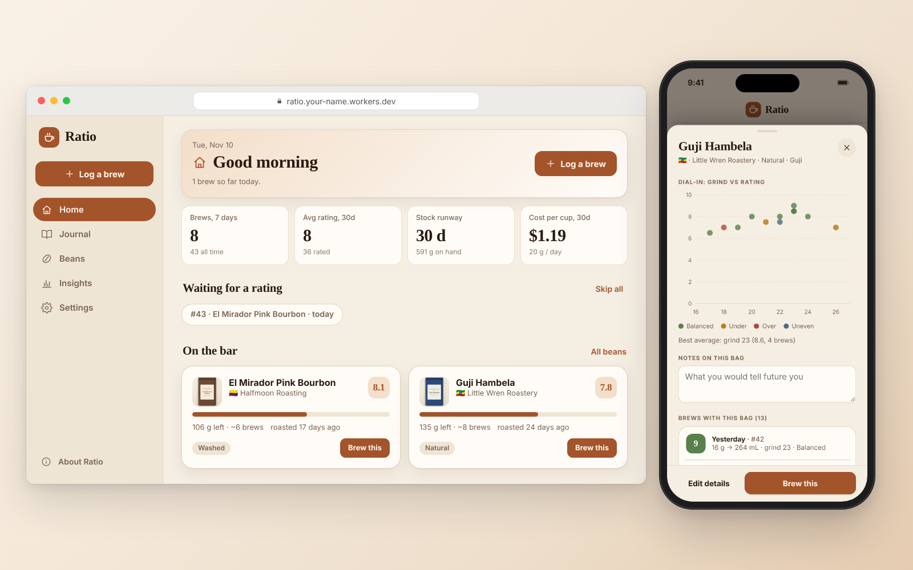

- **Log a brew in seconds.** Pick the bag and Ratio fills in your last recipe: grind, dose, ratio, temperature. Lock the ratio and the water follows the dose. Rate it now or later.
- **Dial in.** Each bag shows how every grind setting rated, your best recipe, and last time’s “next time” note.
- **Every bag, start to finish.** Ordered → resting or freezing → drinking → finished, with dates stamped as you go. See grams left, cups left, cost per cup, and how long your stock will last.
- **Photos.** Snap the bag and the roaster’s logo. Images are resized on your phone and stored in your own R2 bucket.
- **Insights.** A brewing calendar, ratings by origin, process, roaster, method or grinder, which ratios rate best, how your dial-in is trending, top bags, an order again shortlist and spend by roaster.
- **AI assistants.** Connect Claude, ChatGPT or any MCP-capable assistant and talk to your log: “log a V60 of the Kenya, 8 out of 10, a bit sour”, “what grind worked best for the Hologram?”, “move the Gesha out of the freezer”.
- **Built for phones.** Install it to your home screen. It works like an app, and the last-loaded log stays readable offline.
- **Yours.** It runs on your own Cloudflare account. The free plan is plenty. Your data stays in your database.

**Ask your assistant, typed or out loud.** It logs a brew with the right water for your ratio, finds the grind that has worked best, suggests what to order next, and rates a brew you describe on your phone.

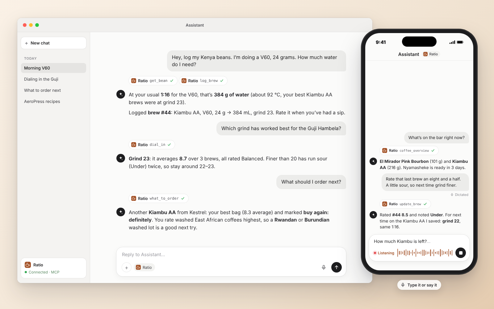

One deployment is one coffee log.

## Screenshots

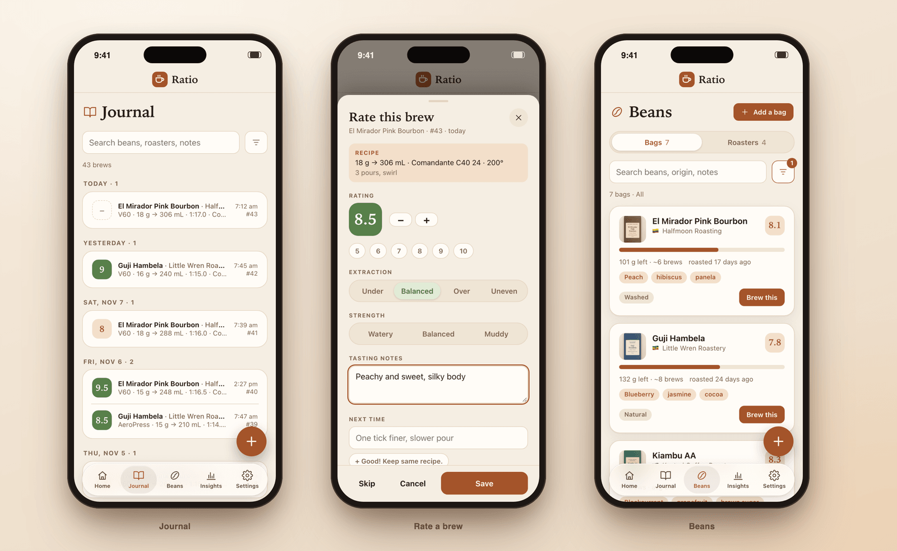

### Logging a brew

Pick the bag and the last recipe is filled in, with your best one a tap away. Lock the ratio and the water follows the dose.

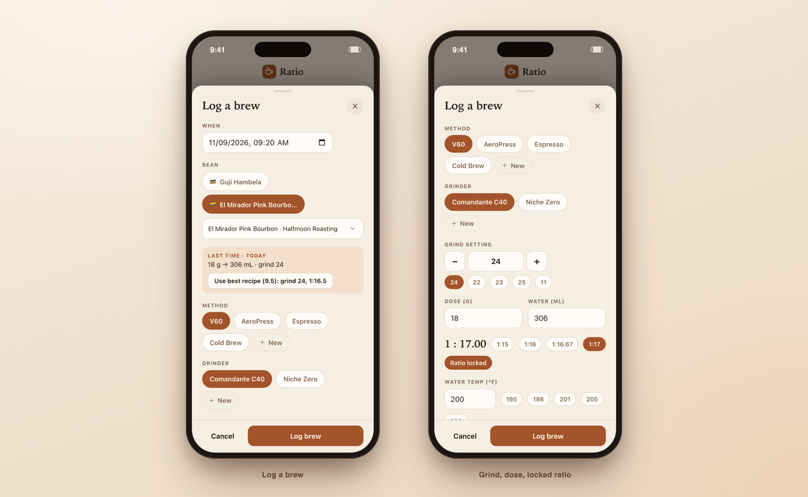

### Journal

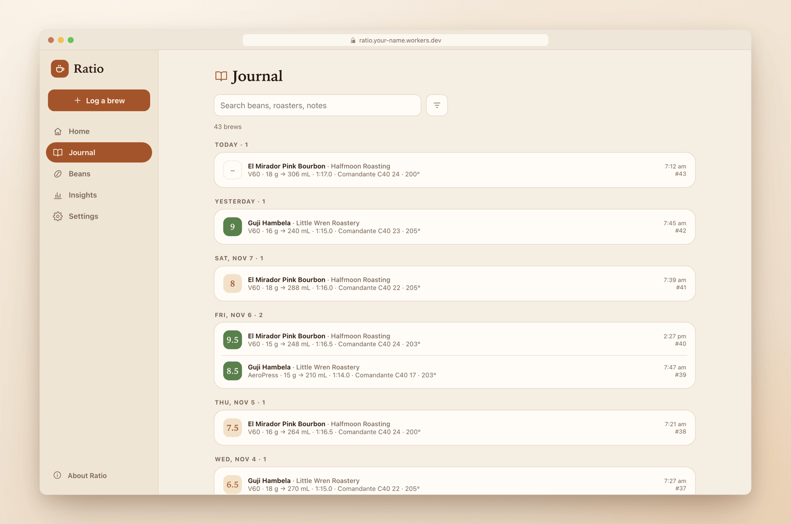

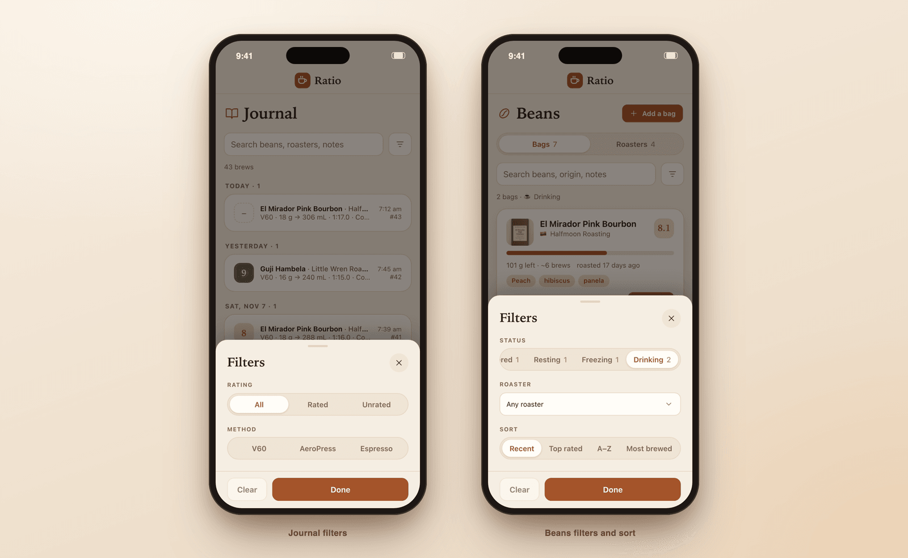

### Beans and roasters

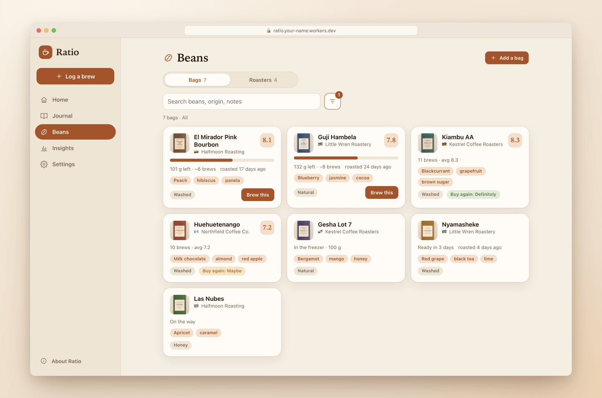

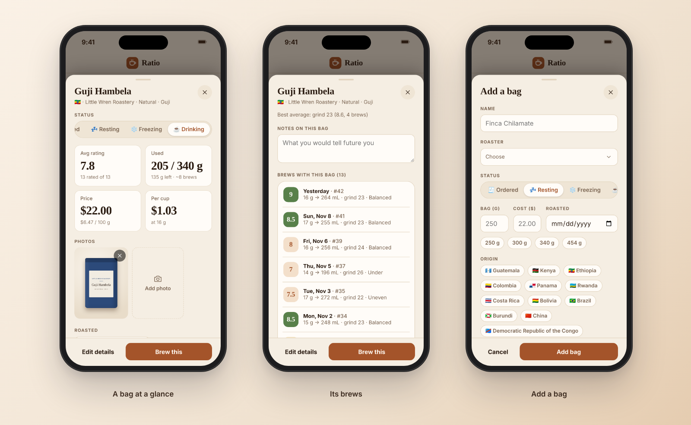

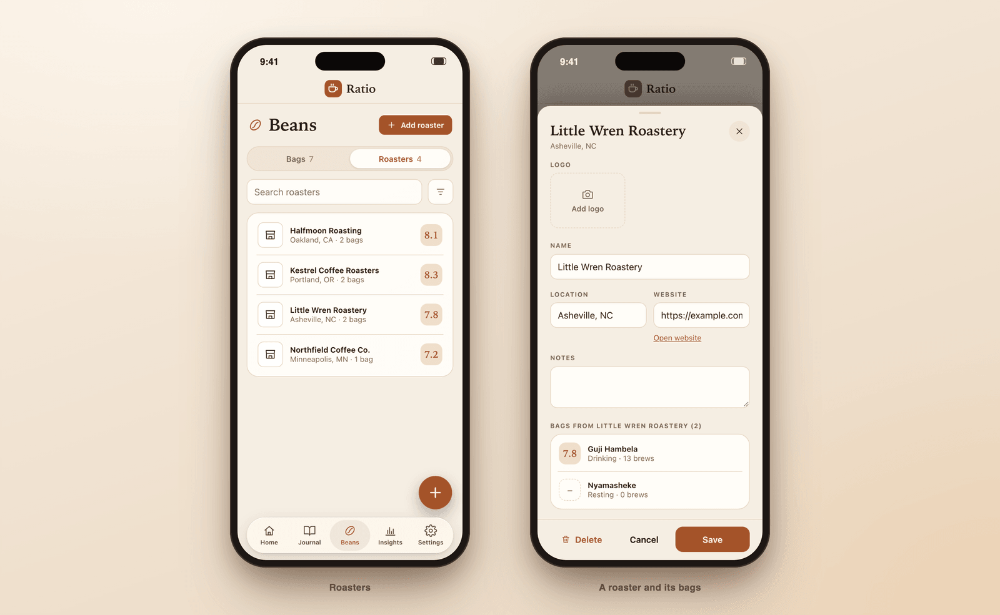

### Insights

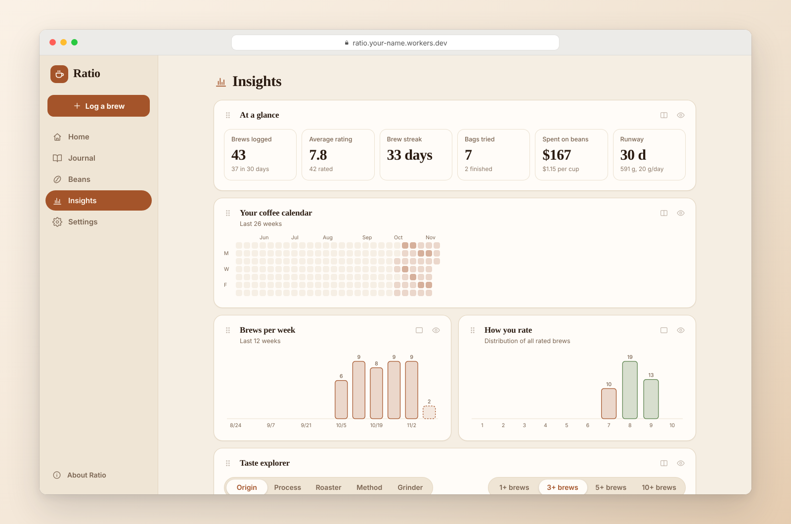

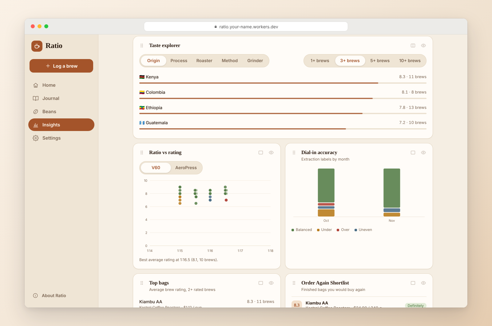

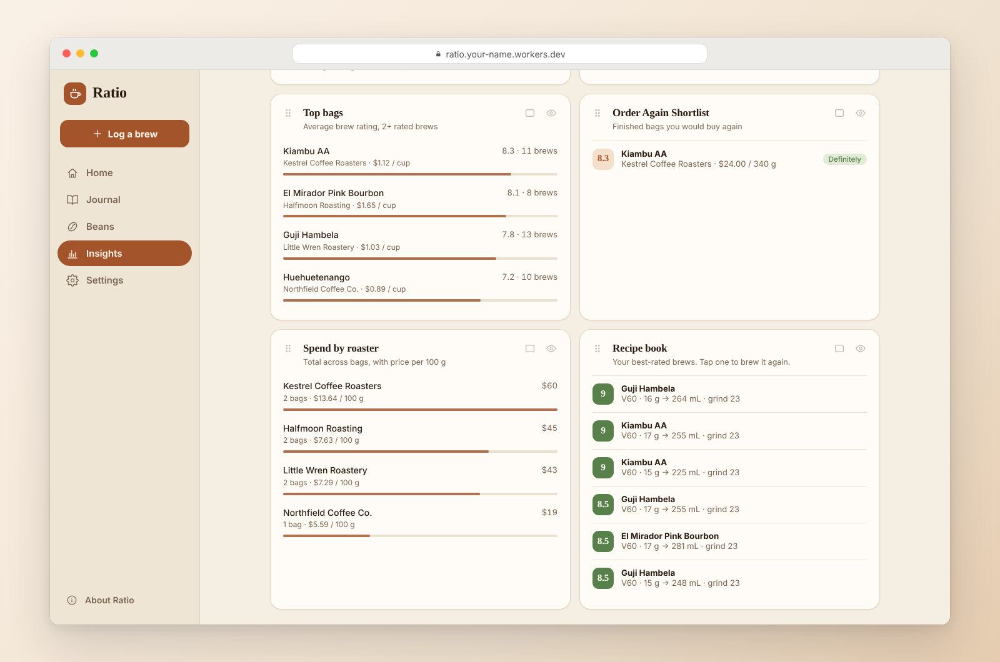

### Settings

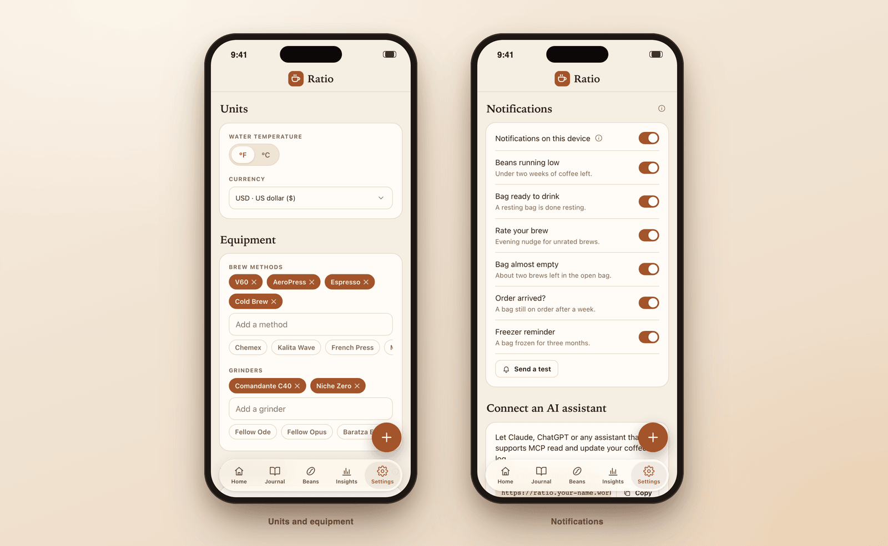

### Dark mode

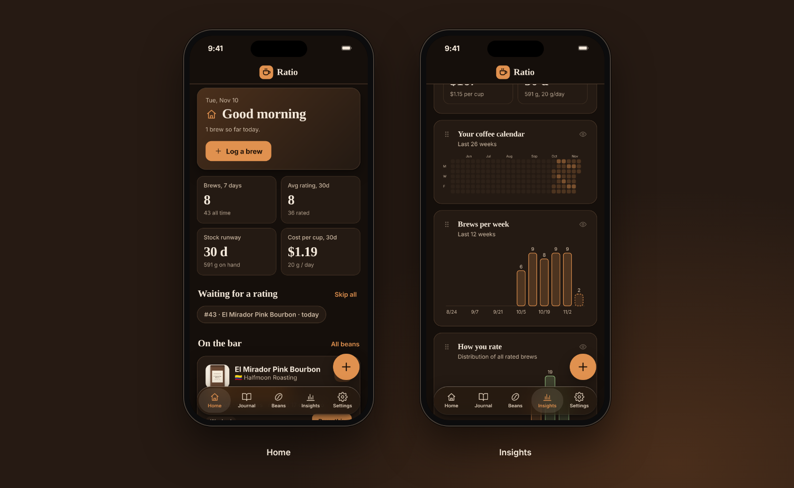

<!-- kit:readme:start -->
<!-- Written by the Selfhost Kit (kit/docs/readme-install.md): edit it there. -->

## Install

You need two free accounts, and about five minutes.

### 1. Have a Cloudflare account

Ratio runs on your own Cloudflare account. The free plan is plenty. If you don't have one, [sign up](https://dash.cloudflare.com/sign-up) and confirm your email.

<!-- 📸 SCREENSHOT docs/screenshots/install-1-cloudflare-signup.png: Cloudflare's sign-up page -->

### 2. Have a GitHub account

The Deploy button makes your own copy of Ratio's code in your GitHub account, so you can keep it updated. If you don't have one, [sign up](https://github.com/signup).

### 3. Let Cloudflare use your GitHub

Cloudflare needs its **Cloudflare Workers and Pages** app installed on your GitHub account to create your copy and deploy it.

1. Open [github.com/apps/cloudflare-workers-and-pages](https://github.com/apps/cloudflare-workers-and-pages) and click **Install** (or **Configure** if it's already installed).
2. Choose your account.
3. Pick **All repositories**. That's simplest, because the Deploy button creates a new one. If you'd rather limit it, choose **Only select repositories** and come back to add your Ratio copy after step 4.
4. Click **Install**.

<!-- 📸 SCREENSHOT docs/screenshots/install-3-github-app.png: GitHub's install page for Cloudflare Workers and Pages, with All repositories selected -->

You can also do this in the middle of the next step: Cloudflare asks you to connect GitHub if you haven't.

### 4. Click Deploy

[](https://deploy.workers.cloudflare.com/?url=https://github.com/tyler-class/ratio)

Sign in to Cloudflare if it asks. You land on a setup page.

<!-- 📸 SCREENSHOT docs/screenshots/install-4-deploy-page.png: Cloudflare's "Create an application" page for Ratio -->

### 5. Check the names (most people keep the defaults)

- **Git account**: your GitHub account.
- **Repository name**: what your copy is called on GitHub. Leave **Create private Git repository** ticked to keep it private.
- **Project name**: the Worker's name, which is also in your address: `https://ratio.<your-subdomain>.workers.dev`.
- **Database and storage names**: what Cloudflare calls the storage it creates for you. Keep them.

### 6. Set your password

Under **Variables and secrets**, fill in **APP_PASSWORD**: the one password everyone in your household uses to sign in. Pick something long. You can change it later (see [Change your password](#change-your-password)), but set it now.

<!-- 📸 SCREENSHOT docs/screenshots/install-6-password.png: The APP_PASSWORD field on the setup page -->

### 7. Create and deploy

Click **Create and deploy**. Cloudflare copies the code to your GitHub, creates the storage and builds Ratio. It takes a minute or two. When the build log finishes, your address is at the end of it, and on the Worker's page under **Domains**.

<!-- 📸 SCREENSHOT docs/screenshots/install-7-build-done.png: A finished build log with the workers.dev address at the end -->

Open it, sign in with your password, and you're done. Bookmark it, or add it to your phone's home screen.

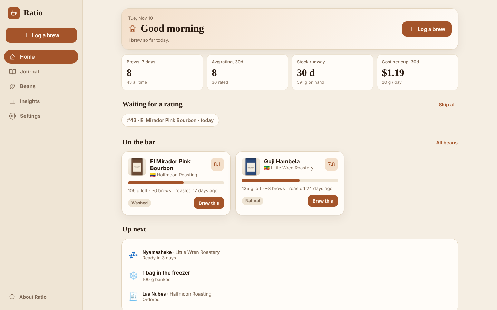

### 8. Set up automatic updates (recommended)

Your copy updates itself every Monday once you allow it. That takes one click, once:

1. In Ratio, open **Settings → Updates** and choose **Set up automatic updates**.
2. GitHub opens with the update file filled in. Click **Commit changes**.

That brings in the latest Ratio straight away, then every week. See [Updates](#updates) for how it works.

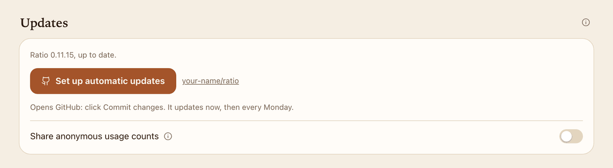
<!-- 📸 SCREENSHOT docs/screenshots/install-8-commit.png: GitHub's new-file page with the update file filled in, and the Commit changes button -->

## Notifications

Ratio can send notifications to your phone. They only work in the app installed on your phone (added to your Home Screen), not in a browser tab.

**Install it on iPhone or iPad** (iOS 16.4 or later):

1. Open Ratio in Safari and tap **Share**.
2. Tap **Add to Home Screen**, then **Add**.
3. Open Ratio from the new Home Screen icon.

**Install it on Android:** open Ratio in Chrome, open the menu **⋮** and tap **Install app** (or **Add to Home screen**), then open it from the new icon.

**Turn them on:** in the installed app, open **Settings → Notifications** and switch on **Notifications on this device**. Allow notifications when your phone asks. Each phone chooses its own, so everyone in the family can pick what they get. **Send a test** checks it's working.

## Updates

Updates take two steps, both in your own accounts. Ratio never deploys to your Cloudflare directly.

1. **Ratio → your GitHub copy.** The update workflow you added in step 8 brings in the latest code every Monday. To update now, open **Settings → Updates → Update now** and click **Run workflow** on GitHub. Settings also tells you when a newer version is out.
2. **Your GitHub copy → your Cloudflare.** Cloudflare builds and deploys every change to your copy, migrating the database first. This was switched on in step 7.

Your data lives in your Cloudflare database and file storage, not in the code, so updates don't touch it. An update replaces the code in your copy, so changes you made to it are overwritten. Your copy's own name and storage settings are kept.

Deployed by hand instead? `git pull`, then `npm run deploy`.

## Change your password

1. In Cloudflare, open **Compute → Workers & Pages** and choose **ratio**.
2. Open the **Settings** tab. Under **Variables and Secrets**, find **APP_PASSWORD** (type **Secret**) and click its pencil icon.
3. Type the new password and save. You can't see the current one, only set a new one.

Everyone is signed out and signs in again with the new password.

<!-- 📸 SCREENSHOT docs/screenshots/password-1-secrets.png: The Variables and Secrets list with APP_PASSWORD and its pencil icon -->

## Use your own domain (advanced)

Your address starts as `https://ratio.<your-subdomain>.workers.dev`. Two ways to change it:

- **Rename your workers.dev subdomain.** In Cloudflare, open **Compute → Workers & Pages**. Your subdomain is shown on the right, with **Change**. It applies to every Worker in your account, so all your apps move together.
- **Give Ratio its own address on a domain you own**, like `ratio.example.com`. The domain has to be on Cloudflare. Open the Worker, go to **Settings → Domains & Routes → Add → Custom domain**, and enter the address. Cloudflare sets up DNS and the certificate. Repeat for each app to give each one its own subdomain.

<!-- 📸 SCREENSHOT docs/screenshots/domain-1-custom-domain.png: Settings → Domains & Routes → Add → Custom domain -->

If you connected an AI assistant, connect it again with the new address.

## Anonymous usage counts

Once a day your copy tells Ratio's developer that it exists: a random id it made for itself, its version, how many roasters, beans, brews and photos it has (counts only), how many files it stores, and whether automatic updates are on. Never names, contents or anything you type, and no IP address is kept. It shows how many copies are in use. Turn it off in **Settings → Updates → Share anonymous usage counts**: your copy sends one last message saying it's off, then nothing.

<!-- kit:readme:end -->

## Use it on your phone

Open your Ratio link on the phone, then:

- **iPhone:** in Safari, tap Share, then **Add to Home Screen**.
- **Android:** in Chrome, open the menu and tap **Install app**.

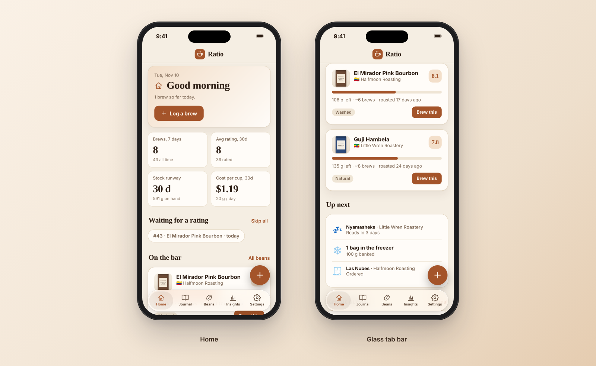

## Connect an AI assistant

Ratio includes an [MCP](https://modelcontextprotocol.io) server at `https://<your-ratio>/mcp`. Open **Settings → Connect an AI assistant** to copy your URL and see steps for Claude, ChatGPT, Claude Code and others. When an assistant connects, Ratio shows a sign-in page; enter your password to approve it. **Disconnect all** in the same place revokes every assistant. Changing the password signs everyone out, but connected assistants keep working until you disconnect them.

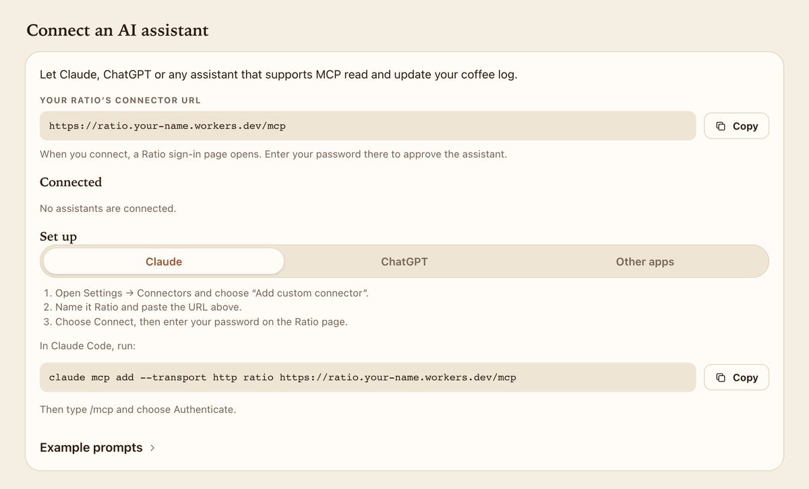

Assistants get these tools:

| Tool                            | What it does                                                                                       |
| ------------------------------- | -------------------------------------------------------------------------------------------------- |
| `coffee_overview`               | What’s open, resting, frozen or coming; recent and unrated brews; stats; equipment; units          |
| `get_started`                   | The log’s current state plus example requests and ready-made prompts                               |
| `find_beans`, `get_bean`        | Search bags; one bag in full with dial-in table, best and last brew                                |
| `list_brews`, `get_brew`        | Search the journal by bean, method, dates, rating or notes                                         |
| `log_brew`                      | Log a brew; anything not given is copied from that bag’s last brew                                 |
| `update_brew`, `delete_brew`    | Rate or fix a brew (“last”, “#392”); delete by number                                              |
| `add_bean`, `update_bean`       | Add a bag (creating its roaster if new); move it along, mark buy-again, edit details               |
| `list_roasters`, `save_roaster` | Roasters with bags, ratings and spend; add or edit one                                             |
| `coffee_insights`               | Ratings by origin/process/roaster/method/grinder/variety, ratio sweet spots, order again shortlist |
| `photo_upload_link`             | A one-time link (30 min) to take or pick a photo on your phone for a bag or logo                   |
| `add_photo`                     | Attach an image from a public URL (e.g. a roaster’s logo) or base64 data                           |

Ask “what can you do with Ratio?” and the assistant calls `get_started`, then suggests a few requests that fit your log. The same examples are under **Try asking** in Settings; tap one to copy it.

Ready-made prompts (in Claude, from the **+** menu):

| Prompt          | What it does                                                                 |
| --------------- | ---------------------------------------------------------------------------- |
| `dial_in`       | Reads every brew of a bag and suggests the next recipe to try                |
| `rate_backlog`  | Walks through recent unrated brews one by one and saves your ratings         |
| `what_to_order` | Suggests coffees from your shortlist and the origins and processes you like  |
| `finish_bag`    | Sums up a bag, marks it finished with your buy-again call, lines up the next |
| `weekly_review` | What you brewed, how it rated, what’s ready to open, how long stock lasts    |

Prompts that would change data ask before they do.

Assistants can’t pass a photo from the chat into a tool, so for “add this photo to the Sumatra” they give you an upload link to tap instead; the photo lands on the bag as soon as it uploads. Names can be loose (“the kenya”, “sey gachatha”); when a name is ambiguous the assistant is told the options. Times without an offset are read in your time zone, which the app reports automatically.

## Back up and restore

**Settings → Backup → Download backup** saves every roaster, bag and brew as one JSON file. **Restore from backup** replaces everything with a backup’s contents. Photos live in the R2 bucket and aren’t in the file; restoring into the same deployment keeps them attached.

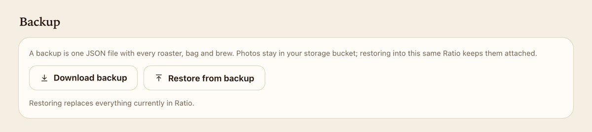

## Deploy by hand

If you’d rather not use the button, or want to work on the code:

```sh
git clone https://github.com/tyler-class/ratio.git && cd ratio
npm install
npx wrangler login
npx wrangler secret put APP_PASSWORD
npm run deploy
```

`npm run deploy` builds the app, applies migrations to the remote database, then deploys the Worker (on the very first deploy, when the database doesn’t exist yet, it deploys first and then migrates). Wrangler creates the D1 database, the R2 bucket (`ratio-images`) and the KV namespace on the first deploy. If your Wrangler version asks you to create them yourself, run `npx wrangler d1 create ratio`, `npx wrangler r2 bucket create ratio-images` and `npx wrangler kv namespace create OAUTH_KV`, then add the ids it prints to `wrangler.jsonc`.

## Local development

```sh
npm install
cp .dev.vars.example .dev.vars    # then set APP_PASSWORD
npm run db:migrate:local
npm run dev
```

| Script                       | What it does                                       |
| ---------------------------- | -------------------------------------------------- |
| `npm run dev`                | Vite dev server with the Worker running in workerd |
| `npm run build` / `preview`  | Production build / serve the build locally         |
| `npm test`                   | Unit tests and Workers-runtime API tests (Vitest)  |
| `npm run typecheck` / `lint` | TypeScript, ESLint and Prettier                    |
| `npm run deploy`             | Build, migrate the remote database, then deploy    |
| `npm run release`            | Migrate, then deploy (no build; Workers Builds)    |
| `npm run db:migrate:local`   | Apply migrations to the local database             |
| `npm run db:migrate:remote`  | Apply migrations to the deployed database          |

### How it’s built

- **Cloudflare Workers** with static assets. **Hono** serves the API under `/api`. **D1** (SQLite) stores roasters, bags, brews and settings; SQL migrations live in `migrations/`.
- **R2** stores images under keys that mirror their record: `beans/<bean id>/<image id>.jpg`, `roasters/<roaster id>/<image id>.png`. D1 keeps each image’s metadata and order.
- **React**, **TypeScript**, **Vite**, **TanStack Query** and **React Router**, with a service worker from `vite-plugin-pwa`. Phones get bottom tabs and sheets; wider screens get a sidebar and dialogs.
- `src/shared` holds the logic both sides use (usage, stock, runway, dial-in, units, time zones), covered by unit tests.
- Sign-in uses one password per instance: a signed, HttpOnly session cookie, rate-limited attempts, and sessions that end when the password changes.
- AI assistants connect over MCP with OAuth 2.1 (`@cloudflare/workers-oauth-provider`). Tokens are stored in KV. MCP tools call the same API as the app, so validation is shared.

## Support

Ratio is free and built by [Tyler Class](https://tylerclass.net). Buy me a coffee to keep it that way: [ko-fi.com/tylerclass](https://ko-fi.com/tylerclass) ☕ Questions or help: [ratio@tylerclass.net](mailto:ratio@tylerclass.net)

## License

[MIT](LICENSE)
